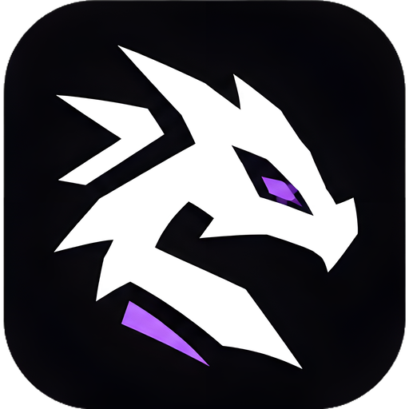
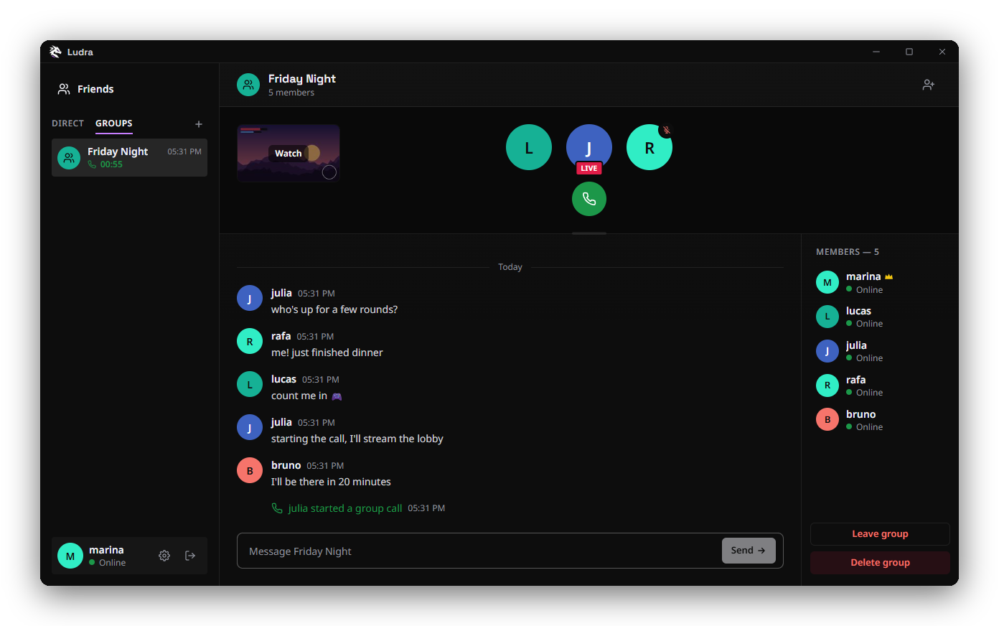

<div align="center">
  

  <h1>Ludra</h1>

  <p>
    <strong>
      Ludra is an open-source app for chatting and playing with friends: messages, groups, voice calls and screen
      sharing, with remote play coming next. The server is written in Go and the desktop app in Tauri and Svelte.
    </strong>
  </p>

  <a href="https://github.com/ludragg/ludra/actions/workflows/build.yml"></a>
  <a href="LICENSE"></a>
  
  

  <br />
  <br />

  
</div>

## Features

- [x] Direct messages and groups of up to 10 people
- [x] Friends, blocking, and Online, Busy and Invisible status
- [x] Voice calls in direct messages and groups, with noise suppression
- [x] Screen sharing up to 1440p at 120 FPS, with system audio
- [x] Call verification with signed signaling and a safety code
- [x] Optional direct connection between friends for lower latency
- [x] Automatic updates
- [x] Portuguese and English
- [ ] Communities with channels
- [ ] Remote play

## Download

Ludra runs on Windows. Builds are published as pre-releases on the
[Releases](https://github.com/ludragg/ludra/releases) page while the app is in early development.

## Running locally

You need Go, Node.js, Rust and Docker.

Start the database and the server:

```sh
docker compose up -d
cd server
go run ./cmd/ludra
```

Then the app, in another terminal:

```sh
cd apps/desktop
npm install
npm run tauri dev
```

The server runs on `127.0.0.1:8080` and runs the database migrations on startup. You can change it with
`LUDRA_ADDR`, `LUDRA_DATABASE_URL` and `LUDRA_ORIGINS`. The app connects to `ws://127.0.0.1:8080/ws`, or to
`VITE_LUDRA_SERVER` if set.

Calls go through the TURN relay built into the server. It listens on UDP `3478` by default and is configured with the
`LUDRA_TURN_*` variables in [`.env.example`](.env.example).

Without SMTP settings, the server prints verification and password reset codes to its log instead of sending
emails. To send real emails, set the variables listed in [`.env.example`](.env.example). With Gmail, use an
[app password](https://myaccount.google.com/apppasswords).

## Project layout

- `apps/desktop`: the desktop app (Svelte in `src`, Rust in `src-tauri`)
- `server`: the Go server
- `protocol`: Protobuf messages shared by both
- `deploy`: Docker Compose setup for hosting your own server, see [`deploy/README.md`](deploy/README.md)

If you change a `.proto` file, run `buf generate` inside `protocol`. If you change a SQL query or migration, run sqlc
inside `server`:

```sh
docker run --rm -v "$PWD:/src" -w /src sqlc/sqlc:1.30.0 generate
```

Before opening a pull request, run `npm run format` and `npm run check` in `apps/desktop`, and `cargo fmt` in
`apps/desktop/src-tauri`. See [`CONTRIBUTING.md`](CONTRIBUTING.md) for the rest.

## Contributors

<a href="https://github.com/ludragg/ludra/graphs/contributors">
  
</a>

## License

Ludra is licensed under the [GNU Affero General Public License v3.0](LICENSE).
